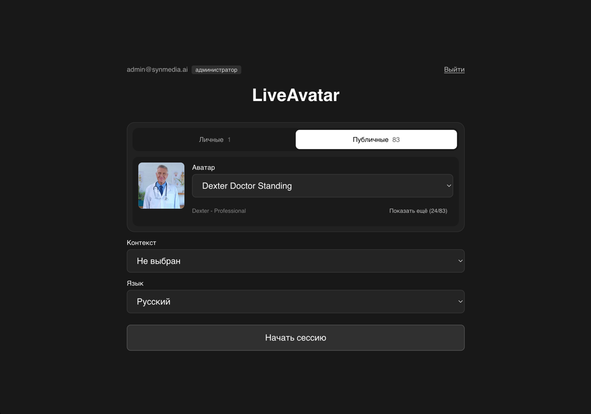
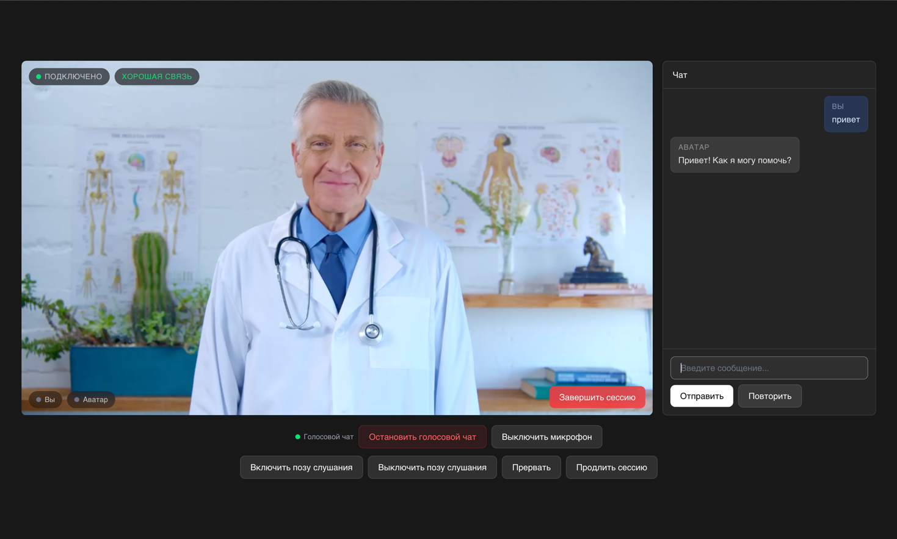

# Live Avatar

**Live Avatar** is a simple Next.js application that allows real-time interaction with an AI-powered avatar via chat or speech. The avatar is rendered and streamed using the [HeyGen API](https://docs.liveavatar.com/), offering a responsive and engaging user experience.

## Interface

### Session setup



Select an avatar, an optional context, and the avatar's spoken language before
starting a session. Administrators can also pick from the shared LiveAvatar
public catalog, which includes a preview and default voice for each avatar.

### Live session



The live session combines the avatar video stream with text chat, connection
status, voice chat, microphone controls, listening-pose controls, and session
management actions.

## Project Structure

```text
.
├── assets/                     # Screenshots used in this README
├── src/
│   ├── app/
│   │   ├── api/                # Authentication and LiveAvatar API routes
│   │   ├── login/              # Login page
│   │   ├── error.tsx           # Global error screen
│   │   ├── layout.tsx          # Root layout and toast container
│   │   └── page.tsx            # Main application page
│   ├── components/             # Session setup and live session UI
│   ├── data/                   # Supported language options
│   ├── hooks/                  # Chat, voice, and session hooks
│   ├── lib/
│   │   ├── auth/               # Users, JWTs, and session cookies
│   │   └── live-avatar/        # LiveAvatar API client and public avatar helpers
│   ├── logic/                  # LiveAvatar SDK context and event handling
│   ├── types/                  # Shared TypeScript types
│   └── proxy.ts                # Authentication guard
├── .env.example                # Environment variable template
├── docker-compose.yml          # Docker Compose configuration
├── Dockerfile                  # Production container image
├── next.config.ts              # Next.js configuration
├── biome.json                  # Biome linter and formatter configuration
├── package.json                # Dependencies and scripts
└── pnpm-workspace.yaml         # pnpm workspace configuration
```

## Getting Started

### 1. Set up environment variables:

Create a .env.local file based on the provided .env.example:

```bash
cp .env.example .env.local
```

Then fill in the required variable:

```
API_KEY_HEYGEN=your-api-key
NEXT_PUBLIC_BASE_API_URL_HEYGEN=https://api.liveavatar.com
```

To get the API_KEY, you need to create it on the official website https://app.liveavatar.com.

Other variables in .env.example are optional and can be configured as needed.

### Authentication

The app is protected by a simple email/password login. Configure users via two
environment variables:

```
# Secret used to sign the session cookie (any long random string).
# Generate one with: openssl rand -base64 32
AUTH_SECRET=change-me-to-a-long-random-string

# Users as a JSON array (single line).
USERS=[{"email":"admin@example.com","password":"admin","role":"admin"},{"email":"user@example.com","password":"user","role":"user","avatarIds":["avatar_id_1"],"contextIds":["context_id_1"],"voiceAgentIds":["voice_agent_id_1"]}]
```

Roles:

- `admin` — access to **all** personal avatars, contexts, voice agents, and the
  public avatar and voice agent catalogs.
- `user` — access only to the avatars, contexts, and voice agents listed in
  `avatarIds`, `contextIds`, and `voiceAgentIds`. The lists are verified
  server-side when a session starts.

### Voice agents

A session can be configured in two ways:

- **Voice agent** (recommended) — pick a stored
  [voice agent](https://docs.liveavatar.com/docs/core-concepts/voice-agents)
  that defines the voice and context; the selected language overrides the
  agent's language for that session. Agents are created in the LiveAvatar
  dashboard. Only `liveavatar_agent` agents are listed, since other types run a
  LITE session that this app does not support.
- **Avatar + context** — the avatar's default voice plus an optional context.
  This uses the deprecated `avatar_persona` API field and is kept until all
  setups move to voice agents.

Passwords are stored in plain text in the `USERS` variable — keep `.env.local`
out of version control.

### 2. Install dependencies:

The project uses pnpm (the version is pinned in `package.json`):

```bash
corepack enable
pnpm install
```

### 3. Run the app locally:

```bash
pnpm dev
```

Open http://localhost:3000 to view it in the browser (or `http://localhost:3000<BASE_PATH>`
if `BASE_PATH` is set).

### Base path

To serve the app under a URL prefix (for example behind a reverse proxy), set
`BASE_PATH`, e.g. `BASE_PATH=/avatar`. Leave it empty to serve from the root.
The value is applied at **build time**: Next.js bakes it into routes and the
client bundle, so the app must be rebuilt after changing it. The session cookie
is scoped to this path.

### Code quality

Linting and formatting are handled by [Biome](https://biomejs.dev/):

```bash
pnpm check       # lint + format check
pnpm check:fix   # apply safe fixes and formatting
pnpm typecheck   # TypeScript
```

## Running with Docker

To launch the app in a Docker container:

```bash
docker compose up --build -d
```

The container reads runtime variables from `.env.local` and listens on
`127.0.0.1:3003`. `BASE_PATH` (default `/avatar`) and
`NEXT_PUBLIC_BASE_API_URL_HEYGEN` (default `https://api.liveavatar.com`) are
build args: Compose takes them from the shell or a `.env` file, not from
`.env.local`:

```bash
BASE_PATH=/my-avatar docker compose up --build -d
```

The image uses Next.js standalone output and runs
as a non-root user.

## License

This project is distributed under the [MIT License](LICENSE).
